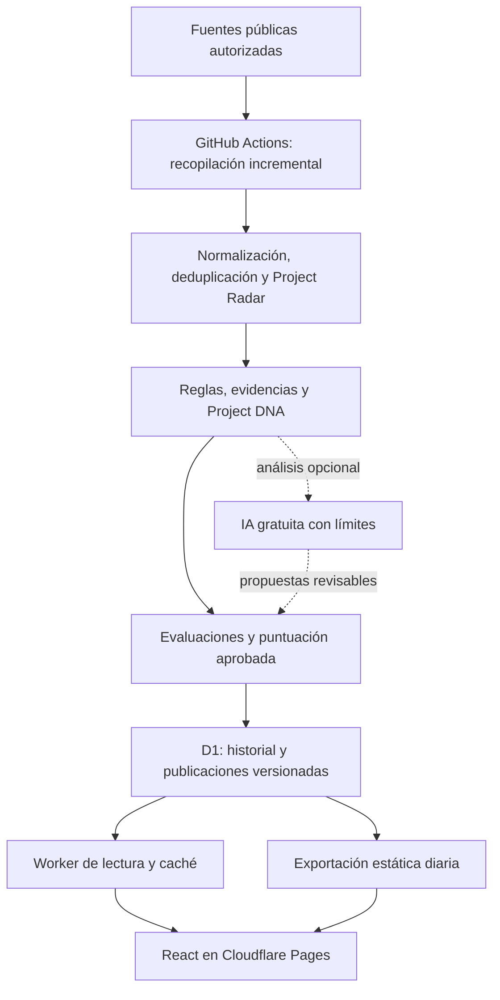

# VI RACE — Documento maestro

**Especificación funcional, técnica y hoja de ruta para Codex**

| Campo | Valor |
| --- | --- |
| Archivo | `VI_RACE_DOCUMENTO_MAESTRO.md` |
| Versión | 2.0 — reconstrucción integral |
| Fecha | 24 de noviembre de 2026 |
| Estado | Especificación para implementar; no acredita una aplicación desplegada |
| Idioma inicial | Español |
| Producto | VI Race — GTA VI Community Project Intelligence |
| Acceso previsto | Público, sin cuenta, desde ordenador y móvil |
| Coste adicional permitido | **0 €** |
| Infraestructura base | GitHub Actions + Cloudflare Pages + Workers Free + D1 Free |
| Evolución futura | TechRadar, producto independiente y fuera del alcance del lanzamiento |

## 1. Procedencia, alcance y autoridad de esta versión

Este documento reconstruye la especificación completa de VI Race a partir de la conversación «Activar seguimiento de proyectos» y del encargo de regeneración. La conversación recuperada conserva objetivos, módulos y decisiones de arquitectura, pero no contiene el archivo original ni el detalle íntegro de sus tablas. Tampoco se ha encontrado una copia del documento en el espacio de trabajo consultado.

Por ello, esta versión **no se presenta como una copia literal del archivo perdido**. Conserva los requisitos recuperables y establece decisiones de implementación explícitas para completar los vacíos. En particular, los nombres, pesos y criterios de los 20 hitos, el modelo relacional, los contratos de API y los umbrales operativos se reconstruyen aquí como especificación normativa nueva.

Los límites de proveedores citados se han contrastado con documentación oficial el 24 de noviembre de 2026. Pueden cambiar: antes del despliegue se volverán a comprobar, sin sustituir nunca una limitación gratuita por un plan de pago.

Orden de prioridad: instrucciones posteriores del propietario, requisitos obligatorios de este documento, criterios de aceptación y decisiones de implementación documentadas. Una mejora de comodidad nunca justifica introducir facturación.

Este es un documento autónomo. VI Race tendrá repositorio, configuración, infraestructura y base de datos propios. No requiere ningún otro proyecto del propietario.

## 2. Visión del producto

VI Race ayudará a entender qué proyectos comunitarios relacionados con la ejecución, compatibilidad y desarrollo técnico de GTA VI en PC existen, qué hacen realmente y qué avances cuentan con pruebas consultables. También distinguirá herramientas auxiliares, investigaciones y anuncios oficiales cuando sean relevantes para interpretar ese panorama.

La pregunta principal será: **«¿Qué ha cambiado, en qué proyecto, qué demuestra y dónde se puede comprobar?»** La aplicación debe responderla en segundos, con explicaciones comprensibles para una persona sin conocimientos técnicos.

No se presupone en esta especificación que exista una versión concreta, un proyecto funcional, una fecha de lanzamiento, una plataforma compatible o un avance confirmado. Esos hechos deberán verificarse al cargar las fuentes reales. Los datos de demostración no se publicarán como descubrimientos reales.

### 2.1 Objetivos inmediatos

- Publicar una primera versión útil en un plazo de días o semanas de trabajo, según acceso y disponibilidad.
- Monitorizar automáticamente fuentes públicas autorizadas y descubrir candidatos nuevos.
- Separar actividad, declaraciones, evidencia y capacidad técnica demostrada.
- Mantener un histórico de cambios, verificaciones y rectificaciones.
- Explicar una clasificación técnica de forma auditable.
- Funcionar sin inteligencia artificial y sin un ordenador personal encendido.
- Mantener accesible la última información publicada ante fallos del procesamiento.

### 2.2 Requisitos obligatorios

| ID | Requisito | Comprobación de aceptación |
| --- | --- | --- |
| R01 | Coste adicional de funcionamiento de 0 € | Planes gratuitos, límites comprobados y ningún servicio con sobrecoste automático habilitado |
| R02 | Aplicación pública adaptable | Navegación completa en móvil y escritorio sin iniciar sesión |
| R03 | Actualización automática | Ejecuciones programadas, cursores persistentes y fecha de última comprobación visible |
| R04 | Descubrimiento de proyectos | Búsquedas configurables y bandeja de candidatos con decisión trazable |
| R05 | Evidencias contrastables | Cada conclusión técnica enlaza pruebas y conserva su historial |
| R06 | 20 hitos, 100 puntos | Validación automática de IDs, pesos, dependencias y suma exacta |
| R07 | Continuidad sin IA | Recopilación, reglas, clasificación aprobada y UI operativas con IA desactivada |
| R08 | Transparencia | Incertidumbre, errores, antigüedad y método de puntuación visibles |
| R09 | Aislamiento | Recursos, secretos y datos exclusivos de VI Race |
| R10 | Evolución sin retrasar el MVP | Contratos reutilizables; ninguna funcionalidad universal necesaria para publicar |

### 2.3 Fuera del primer lanzamiento

Registro de visitantes, perfiles, comentarios, mensajería, aplicación móvil nativa, pagos, publicidad, notificaciones personales, rastreo privado y ejecución de proyectos externos. Tampoco se desarrollará ahora una plataforma universal de seguimiento tecnológico.

No se alojarán copias del juego, claves, archivos comerciales ni descargas ejecutables de terceros. El servicio analizará información pública y enlazará fuentes pertinentes. Un enlace a un repositorio no equivale a una recomendación de instalación ni a una certificación de seguridad.

## 3. Conceptos y clasificación de proyectos

### 3.1 Entidades principales

**Proyecto:** iniciativa técnica identificada por un ID interno estable. Puede tener varios repositorios y cambiar de nombre.

**Repositorio:** contenedor de código o documentación, identificado preferentemente por su ID estable del proveedor, no solo por `owner/name`.

**Fuente:** lugar autorizado del que se obtiene una observación: API, release, documentación, publicación técnica o feed.

**Evento:** cambio observado, por ejemplo un commit nuevo o una release. Su existencia no demuestra por sí sola una capacidad.

**Afirmación:** proposición que alguien sostiene, como «renderiza una escena». Se conserva quién lo afirma y sobre qué versión.

**Evidencia:** material concreto que permite evaluar una afirmación. Debe tener procedencia, fecha y alcance.

**Evaluación:** decisión razonada que vincula evidencia, proyecto, versión e hito.

**Publicación:** conjunto coherente de resultados ya calculados que puede consultar el público.

### 3.2 Tipos de proyecto

| Tipo | Ejemplos de alcance | Tratamiento |
| --- | --- | --- |
| Ruta completa de ejecución | Capa de compatibilidad, emulación o adaptación que declara intentar ejecutar el juego en PC | Elegible para la clasificación técnica común si su alcance está verificado |
| Componente | Traducción de instrucciones, renderizador, cargador o biblioteca | Ficha propia; mostrar capacidades demostradas, sin compararlo como solución completa |
| Herramienta auxiliar | Analizador, extractor autorizado, utilidades de desarrollo | Seguimiento de actividad y evidencias; fuera de la carrera de ejecución |
| Investigación | Documentación técnica o prueba de concepto | Mostrar alcance y limitaciones; sin presentarla como producto funcional |
| Información oficial | Comunicados y documentación de los titulares correspondientes | Contexto separado de proyectos comunitarios |
| Candidato sin clasificar | Repositorio descubierto con identidad o relevancia pendiente | Bandeja de revisión; fuera de la clasificación principal |

La elegibilidad requiere que el proyecto esté identificado, tenga relevancia documentada y declare un alcance comparable. El número de estrellas, las visitas o la popularidad no determinan la categoría ni la puntuación.

## 4. Arquitectura gratuita de referencia

### 4.1 Decisión central

**GitHub Actions realizará el procesamiento periódico y Cloudflare alojará la web y los resultados.** El visitante consultará datos previamente calculados. Abrir una página, filtrar una tabla o pulsar actualizar no ejecutará búsquedas externas ni análisis con IA.



### 4.2 Responsabilidades y tecnologías

| Capa | Tecnología inicial | Responsabilidad |
| --- | --- | --- |
| Interfaz | React + TypeScript + Vite | Dashboard, fichas, filtros, histórico y accesibilidad |
| Gráficos | Recharts, cargado cuando sea necesario | Evolución de puntuación y actividad con alternativa textual |
| Recolección | Node.js LTS + TypeScript en GitHub Actions | APIs, feeds, comparaciones y manejo de cuotas |
| Dominio | Paquetes TypeScript puros | Identidad, reglas, evidencias y cálculo determinista |
| Persistencia | Cloudflare D1, SQLite | Estado incremental, relaciones, decisiones e histórico |
| API pública | Cloudflare Worker Free | Servir publicaciones preparadas con consultas indexadas |
| Alojamiento | Cloudflare Pages Free | Archivos estáticos, dominio `pages.dev` y copia de respaldo |
| Análisis opcional | Workers AI en modalidad gratuita | Proponer resúmenes y señales, sin autoridad para confirmar hitos |
| Pruebas | Vitest, pruebas de integración y Playwright | Dominio, persistencia, adaptadores y recorridos de UI |
| Validación de contratos | JSON Schema o Zod | Entradas externas, configuración y respuestas públicas |

Se fijarán versiones compatibles en el archivo de bloqueo al comenzar. No se utilizarán características de pago para implementar una función básica.

### 4.3 Flujo de escritura

Actions accederá a D1 mediante la API de infraestructura de Cloudflare con un token limitado a los recursos necesarios, almacenado como secreto de GitHub. No existirá un endpoint público de escritura o de administración en el Worker del MVP.

El trabajo recuperará los cursores persistentes, descargará únicamente cambios, validará los registros, ejecutará reglas, guardará hechos e historial y construirá una publicación. Solo después de completarla cambiará el puntero de publicación actual. Un fallo parcial no reemplazará la última versión válida.

El token de despliegue de Pages estará separado del token de datos cuando los permisos del proveedor permitan ese aislamiento. No se solicitarán credenciales de servicios de pago ni claves de modelos de IA facturados por uso.

### 4.4 Flujo de lectura

La UI cargará primero una exportación estática incluida en Pages y después intentará obtener la publicación actual del Worker. Si falla la API, conservará la copia disponible y mostrará su fecha real.

El Worker devolverá JSON ya preparado. No hará scraping, análisis de código, cálculo de puntuaciones ni inferencias. Las rutas de publicación usarán IDs de versión para evitar mezclar una ficha nueva con un resumen antiguo.

La caché reducirá lecturas a D1, pero **no se considerará una forma de eliminar la cuota de invocaciones del Worker**. Cada nueva consulta pública puede consumir esa cuota. El modo de respaldo estático deberá poder funcionar sin el Worker.

### 4.5 Servicios que no son necesarios

No se necesitan VPS, GPU alojada, base de datos de pago, servicios de búsqueda comercial, colas de pago, correo transaccional, proxy residencial ni dominio comprado. KV será una optimización opcional posterior; no forma parte de la persistencia obligatoria ni de los bloqueos de concurrencia. R2 tampoco es necesario para el MVP.

## 5. Frecuencias y límites de tiempo real

La conversación proponía inicialmente comprobaciones cada 2–5 minutos. La arquitectura final con Actions requiere una precisión: el intervalo mínimo programado admitido es de cinco minutos y las ejecuciones pueden retrasarse o descartarse. No se prometerá una latencia de dos minutos ni un servicio con garantía de tiempo real. [GitHub: ejecución programada](https://docs.github.com/en/actions/reference/workflows-and-actions/events-that-trigger-workflows#schedule).

Configuración inicial, ajustable sin modificar código:

| Trabajo | Frecuencia objetivo inicial | Política |
| --- | --- | --- |
| Repositorios prioritarios | Cada 10 minutos | Bajar a 5 minutos solo tras comprobar duración y cuotas |
| Repositorios secundarios | Cada 30 minutos | Selección por `next_due_at`, sin volver a consultar todo |
| Descubrimiento | Cada 60 minutos | Adelantar hasta 15 minutos si el presupuesto lo permite |
| Feeds técnicos y noticias autorizadas | Cada 60 minutos | Respetar frecuencia y condiciones de cada fuente |
| Revisión de candidatos | En cada ciclo con cambios | Límite de candidatos procesados por ejecución |
| Análisis opcional con IA | Solo ante cambios relevantes | Cola limitada y deduplicada |
| UI visible | Consulta inicial y cada 120 segundos | Pausar en pestañas ocultas; retroceso ante errores |
| Exportación estática de respaldo | Una vez al día si hay cambios | También al publicar código cuando sea útil |
| Compactación, métricas y respaldo | Una vez al día | Sin competir con la recopilación prioritaria |

La UI permitirá un botón «Comprobar datos publicados» con limitación local. Este botón solo volverá a consultar la publicación compartida. No forzará una ejecución de Actions.

Objetivo operativo inicial: que el 95 % de los ciclos prioritarios termine en menos de ocho minutos y que se detecten fallos de frescura. Es un objetivo que debe medirse, no un rendimiento ya acreditado. Las limitaciones de un plan gratuito se harán visibles al usuario.

Separar siempre `source_published_at`, `observed_at`, `last_checked_at` y `snapshot_generated_at`. Una comprobación sin cambios actualizará la frescura de la fuente, pero no creará un supuesto avance técnico.

## 6. Coste cero y presupuesto de recursos

### 6.1 Condición de uso

Los siguientes límites son referencias del plan gratuito consultado, no derechos permanentes ni recursos reservados exclusivamente para esta aplicación. Si otros recursos comparten cuenta o cuota, se descontará su consumo. Una cuenta que ya esté en un plan de pago no satisface automáticamente la condición de bloqueo de sobrecostes: habrá que aislar el despliegue en un entorno gratuito o detenerlo hasta resolverlo.

| Servicio | Referencia gratuita contrastada | Política de VI Race |
| --- | --- | --- |
| Actions | Runners estándar gratuitos en repositorios públicos; los runners grandes son facturables | Repositorio público, runner Linux estándar, sin servicios ni almacenamiento ampliados |
| Pages | 500 builds al mes y 25 MiB máximos por archivo | Desplegar código y respaldo diario; nunca una build por cada ciclo de monitorización |
| Workers Free | 100.000 solicitudes al día y 10 ms de CPU por invocación | API ligera; reducir polling y recurrir al respaldo ante agotamiento |
| D1 Free | 5 millones de filas leídas/día, 100.000 escritas/día y 5 GB por cuenta | Medir filas reales e índices; mantener una base pequeña |
| D1 por base Free | 500 MB máximos | Retención y compactación antes de aproximarse al límite |
| Workers AI | Asignación gratuita de 10.000 neuronas/día; algunos modelos exigen pago | Desactivado por defecto; solo modelos confirmados como gratuitos |

Referencias: [Actions y facturación](https://docs.github.com/en/billing/concepts/product-billing/github-actions), [Pages](https://developers.cloudflare.com/pages/platform/limits/), [Workers](https://developers.cloudflare.com/workers/platform/pricing/), [D1: uso](https://developers.cloudflare.com/d1/platform/pricing/), [D1: límites](https://developers.cloudflare.com/d1/platform/limits/), [Workers AI](https://developers.cloudflare.com/workers-ai/platform/pricing/).

KV, si se introduce más adelante, tiene sus propias cuotas de lectura y escritura y consistencia eventual. No se usará para decidir quién puede escribir o para mantener contadores financieros exactos. [Límites de KV](https://developers.cloudflare.com/kv/platform/limits/), [consistencia de KV](https://developers.cloudflare.com/kv/concepts/how-kv-works/).

### 6.2 Presupuestos internos iniciales

Estos valores son decisiones conservadoras de la aplicación, no límites oficiales:

| Recurso | Presupuesto o umbral inicial |
| --- | --- |
| Proyectos activos | 20, ampliables tras medir |
| Tiempo máximo por job de monitorización | 8 minutos |
| Solicitudes GitHub por ciclo de 10 minutos | 100 como techo; menos si quedan pocas solicitudes |
| Reserva GitHub | Parar trabajo secundario por debajo del 20 % disponible |
| Publicación principal | 250 KiB sin comprimir como objetivo máximo |
| Bloques de detalle o histórico | 100 KiB por bloque como objetivo máximo |
| Filas D1 leídas por día | Aviso a 2 millones; reducir trabajo a 3 millones |
| Filas D1 escritas por día | Aviso a 40.000; reducir trabajo a 60.000 |
| Tamaño D1 | Aviso a 250 MB; compactación prioritaria a 350 MB |
| Solicitudes Worker por día | Aviso a 50.000; modo de ahorro a 70.000 si la métrica está disponible |
| Almacenamiento de artifacts de Actions | No usarlos como base de datos; techo propio de 50 MB |
| IA | Máximo 10 propuestas/día y estimación inferior a 5.000 neuronas; detenerse antes si hay incertidumbre |

Los contadores locales de tráfico distribuido son aproximados. No se anunciará que estos umbrales garantizan impedir todas las invocaciones. El límite gratuito del proveedor y la ausencia de facturación habilitada son la última barrera. Las métricas de cuenta pueden llegar con retraso.

### 6.3 Ejemplo de capacidad

Con diez repositorios prioritarios, dos comprobaciones por repositorio cada diez minutos suponen unas 120 peticiones/hora. Quedan hasta 480 peticiones/hora dentro del techo interno de 100 por ciclo para detalles selectivos y trabajo secundario. Es un ejemplo de planificación: la paginación, los repositorios adicionales y los reintentos también consumen presupuesto.

Con 500 visitantes que mantengan abierta una pestaña durante 30 minutos, el polling cada dos minutos puede generar unas 8.000 consultas, incluyendo una consulta inicial por visitante. Con miles de sesiones más largas podría agotarse la cuota del Worker. El número de visitantes no multiplica las consultas a las fuentes ni a la IA, pero sí puede multiplicar las lecturas de la API pública.

La exportación estática diaria evita vincular cada cambio de datos a una nueva build de Pages. Una build diaria de respaldo serían unas 30 al mes, además de las de código y las previsualizaciones.

### 6.4 Prohibiciones económicas

- No activar planes de pago, recargas, créditos prepagados ni renovación de pruebas gratuitas.
- No usar runners grandes, servidores personales permanentes ni infraestructura cuyo exceso se facture.
- No introducir claves de APIs de pago como solución a una cuota agotada.
- No usar las sesiones de herramientas de desarrollo del propietario como backend público automatizado.
- No activar un fallback de IA de pago.
- No asumir que un aviso de gasto equivale a un bloqueo de gasto.

Si un proveedor elimina una opción gratuita, se deshabilitará el adaptador o se mantendrá la última publicación. La aplicación puede perder frescura antes que generar una factura. No se promete capacidad ilimitada ni disponibilidad continua bajo cualquier volumen de tráfico.

## 7. Monitorización y recolección de fuentes

### 7.1 GitHub como fuente inicial

Recopilar de forma selectiva metadatos del repositorio, rama predeterminada, commits recientes, releases, etiquetas, cambios relevantes de README y documentación, estado archivado y señales de traslado. Issues y pull requests solo cuando sean relevantes y el presupuesto lo permita.

No descargar el historial completo en cada ciclo. Primero comprobar metadatos o HEAD; después recuperar el intervalo desde el cursor persistido. Comparar archivos técnicos únicamente ante cambios que lo justifiquen y con límites de tamaño.

Usar el `GITHUB_TOKEN` del workflow para datos públicos cuando sea suficiente. Su límite de referencia es de 1.000 solicitudes/hora por repositorio del workflow; no debe confundirse con la cuota de un token personal. Respetar además límites secundarios y los específicos de búsqueda. [GitHub: límites de API](https://docs.github.com/en/rest/using-the-rest-api/rate-limits-for-the-rest-api).

### 7.2 Protocolo de adaptadores

Cada adaptador implementará `discover`, cuando proceda, y `collect`. Recibirá configuración, cursor, presupuesto restante y reloj; devolverá observaciones normalizadas, siguiente cursor, consumos y diagnósticos. No escribirá directamente puntuaciones.

El cliente HTTP deberá:

1. Usar HTTPS, identificación del cliente, tiempos máximos y límites de tamaño.
2. Persistir ETag y Last-Modified donde se admitan.
3. Reutilizar parámetros estables y seguir paginación oficial.
4. Procesar peticiones de forma secuencial inicialmente.
5. Interpretar 304 como comprobación válida sin cambios.
6. Respetar `Retry-After`, `x-ratelimit-reset` y `x-poll-interval` si aparecen.
7. Aplicar un máximo de dos reintentos con espera progresiva para fallos transitorios.
8. No reintentar de inmediato errores de autenticación, validación o cuota agotada.
9. Guardar cursor solo después de persistir correctamente el lote correspondiente.

Las peticiones condicionales autenticadas con respuesta 304 pueden ahorrar cuota primaria en GitHub, pero no se tratarán como exentas de todos los límites del servicio. [Buenas prácticas de la API](https://docs.github.com/en/rest/using-the-rest-api/best-practices-for-using-the-rest-api).

### 7.3 Otras fuentes

Los feeds RSS/Atom y documentos públicos permitidos serán la siguiente prioridad. Reddit y otras plataformas con autorización o condiciones específicas permanecerán desactivadas hasta comprobar su acceso permitido y gratuito. Ninguna de ellas bloqueará el lanzamiento.

Los rastreadores externos solo se incorporarán mediante adaptadores revisados, con atribución y condiciones de acceso registradas. No se hará scraping indiscriminado, no se sortearán bloqueos y no se usarán navegadores con sesiones personales para automatizar la recopilación.

### 7.4 Identidad, duplicados e inaccesibilidad

La clave de un commit será proveedor, ID de repositorio y SHA. La de una release usará el ID estable de la plataforma. Para feeds se usará GUID o URL canónica, más una huella del contenido normalizado cuando sea necesario.

Un 404 aislado significa «fuente no accesible en esta comprobación». Puede indicar permisos, traslado, borrado o fallo. Solo tras tres comprobaciones espaciadas y revisión del contexto se marcará como «inaccesible». Nunca se convertirá automáticamente en «abandono», «fraude» o pérdida de puntos.

Un repositorio archivado o sin commits mantendrá sus logros demostrados. La actividad y el mantenimiento se mostrarán por separado.

## 8. Project Radar: descubrimiento automático

### 8.1 Descubrir sin promocionar automáticamente

Project Radar localizará candidatos que puedan ser relevantes. Descubrir un nombre relacionado con GTA VI no acredita un proyecto técnico ni su legitimidad. Un candidato nuevo entrará como `pending_review` y no en la clasificación principal.

Mecanismos iniciales:

- Búsquedas de repositorios por variantes configurables de nombre, descripción y temas.
- Seguimiento de forks y organizaciones ya admitidas cuando aporten señales concretas.
- Enlaces salientes de documentación de proyectos conocidos, revisados antes de incorporarlos.
- Cambios de nombre, transferencias y sucesores propuestos.
- Incorporación manual mediante cambios de configuración revisables.

Ejemplos de familias de consulta: `"GTA VI"`, `"GTA6"`, `"Grand Theft Auto VI"`, combinadas con términos de compatibilidad, emulación, investigación y herramientas. Son expresiones de descubrimiento, no una lista de resultados verificados. Se dividirán búsquedas por fecha o tema cuando sea necesario, sin prometer cobertura exhaustiva de GitHub.

### 8.2 Relevancia y revisión

El filtrado determinista recogerá coincidencia temática, existencia de material técnico, referencias de proyectos conocidos y señales de duplicación. Las estrellas y la antigüedad podrán orientar la revisión, nunca confirmar capacidad ni excluir por sí solas un proyecto nuevo.

Estados de candidato: `pending_review`, `accepted`, `rejected`, `duplicate`, `deferred`. Cada transición guardará responsable, motivo y fecha. Un candidato podrá ser relevante como herramienta aunque no sea elegible para la carrera de ejecución.

La promoción se realizará mediante registro de revisión en el repositorio, validado por el pipeline y asociado a su commit. Rechazos y duplicados se conservarán para evitar redescubrir indefinidamente lo mismo. Los candidatos pendientes permanecerán disponibles en una vista separada, con advertencia clara de revisión pendiente.

### 8.3 Criterios de aceptación del Radar

Una búsqueda de prueba debe descubrir un repositorio relevante sintético, evitar duplicarlo al repetirse y excluir resultados irrelevantes de la clasificación. Un renombrado conservará la identidad. Una búsqueda que falle no vaciará la bandeja existente. Se publicará la hora de la última búsqueda satisfactoria y cualquier limitación de cobertura.

## 9. Project DNA: identidad y relaciones

Project DNA ayudará a identificar forks, renombrados, componentes compartidos, sucesores y posibles duplicaciones. No será un detector automático de mala conducta.

Orden de señales:

1. ID estable de repositorio y relaciones oficiales `parent` o `source`.
2. Transferencias y redirecciones verificadas por el proveedor.
3. Commits comunes, historial y autores públicos relevantes.
4. Huellas de archivos técnicos seleccionados, excluyendo dependencias y código generado.
5. Referencias documentales y declaraciones de los responsables.

El nombre similar o un README copiado serán señales débiles. Las huellas textuales no demuestran por sí solas procedencia, licencia ni fraude. La ausencia de parentesco oficial tampoco demuestra independencia.

Relaciones admitidas: `fork_of`, `renamed_from`, `successor_of`, `component_of`, `shares_code_with`, `possible_duplicate`. Toda relación tendrá evidencia, grado de confianza, fecha y estado de revisión. Solo se fusionarán identidades cuando esté comprobado que se trata de la misma entidad; un fork tendrá su propio ID.

No se heredarán puntos automáticamente de un proyecto padre. Un fork podrá aportar pruebas de capacidades heredadas, pero deberán vincularse a la versión evaluada y quedar justificadas. Una relación dudosa se mostrará como propuesta, sin modificar la clasificación.

## 10. Análisis de evidencias

### 10.1 Qué debe conservar una evidencia

Cada evidencia incluirá ID, proyecto, fuente, URL canónica, enlace permanente cuando exista, tipo de material, autor público pertinente, fecha de publicación, fecha de observación, commit o versión, alcance técnico, extracto mínimo o resumen propio, hash del material observado y condiciones de conservación.

También recogerá si la afirmación es directa o inferida, qué hito puede respaldar, qué limitaciones tiene y si existe contradicción. No se copiarán artículos completos ni archivos ajenos sin permiso. Una huella criptográfica identifica una captura observada; no certifica por sí sola que el material sea auténtico o verdadero.

### 10.2 Niveles de evidencia

| Nivel | Material | Uso permitido |
| --- | --- | --- |
| E0 — Declaración | README, comentario o anuncio sin prueba técnica suficiente | Registrar afirmación; cero puntos |
| E1 — Indicio técnico | Código relacionado o log parcial con contexto limitado | Proponer revisión; cero puntos por sí solo |
| E2 — Demostración documentada | Código, logs, vídeo contextualizado o pruebas identificables sobre una versión | Sustentar una evaluación, especificando qué muestra y qué no |
| E3 — Corroboración independiente | Reproducción o comprobación técnica por una parte independiente con pasos y entorno | Respaldar confirmación cuando se cumpla la rúbrica del hito |

Varias noticias que copian un mismo anuncio son una sola cadena de procedencia. Un vídeo puede aportar una demostración visual, pero su presencia no acredita reproducción independiente ni la autenticidad de todos los detalles técnicos.

### 10.3 Estados y autoridad

Estados de evaluación: `unassessed`, `claimed`, `in_review`, `confirmed`, `disputed`, `refuted`, `regressed`, `not_applicable`.

- `unassessed`: no hay evaluación suficiente; no significa fallo demostrado.
- `claimed`: existe una declaración identificada.
- `in_review`: hay material pendiente de contrastar.
- `confirmed`: la rúbrica está satisfecha y una revisión humana registrada lo aprueba.
- `disputed`: aparece una contradicción material no resuelta; se suspenden los puntos.
- `refuted`: las pruebas contradicen la afirmación evaluada.
- `regressed`: una versión actual pierde una capacidad anteriormente confirmada.
- `not_applicable`: el hito queda fuera del alcance de ese tipo de componente; no aumenta la puntuación.

Ni la IA ni una coincidencia de palabras clave pueden producir `confirmed`. El motor automático puede crear propuestas o señalar material para revisión. La aceptación humana se registrará en un archivo de revisión versionado, con evidencia, motivo, revisor y commit de aprobación. En el MVP, el revisor será un mantenedor autorizado; no hace falta un panel privado.

### 10.4 Reglas de confirmación

Para confirmar un hito se requiere material E2 suficiente, contexto de versión, cumplimiento de todos sus criterios y corroboración independiente E3 o una comprobación técnica independiente documentada que sea apropiada para ese hito. Un hito puramente documental puede comprobarse leyendo los documentos públicos; no requiere ejecutar software.

Cuando no sea posible comprobar la capacidad con el acceso disponible, permanecerá en revisión. Una fecha, un número de versión y un enlace por sí solos no sustituyen una prueba técnica.

La revisión de una capacidad que requiere ejecución podrá apoyarse en informes externos verificables. **El pipeline de VI Race nunca ejecutará binarios ni scripts de un proyecto monitorizado.** La aplicación registra y valora evidencias; no es un servicio automático de ejecución de software ajeno.

### 10.5 Confianza y rectificaciones

Usar las etiquetas `baja`, `media` y `alta` con una explicación de procedencia, independencia, completitud y consistencia. No presentarlas como probabilidades estadísticas. La confianza se mostrará junto al estado y no multiplicará los puntos.

Una contradicción importante suspenderá la confirmación afectada y generará una revisión prioritaria. No se eliminarán decisiones antiguas: se añadirán nuevas con su justificación. La UI diferenciará «mejor capacidad histórica» de «capacidad de la versión actual». Si la fuente desaparece pero existe una evidencia válida conservada conforme a sus condiciones, no se retirarán puntos sin una razón técnica.

## 11. Los 20 hitos técnicos ponderados

### 11.1 Finalidad de la rúbrica

La rúbrica `vi-pc-v1` mide **capacidad técnica demostrada en una ruta completa hacia ejecución en PC**. Su total es exactamente 100 puntos. No mide la probabilidad de éxito, el tiempo restante, el porcentaje real de desarrollo del juego ni una fecha de disponibilidad.

Los proyectos de componentes tendrán la misma ficha de evidencias, pero no se compararán en la clasificación de soluciones completas. No se recalculará un 100 % usando solo los hitos que resulten cómodos para un proyecto. Para rutas técnicas distintas, una equivalencia deberá documentarse y revisarse antes de puntuarse.

### 11.2 Tabla normativa

| ID | Hito | Peso | Criterio mínimo para confirmarlo |
| --- | --- | ---: | --- |
| M01 | Alcance y arquitectura técnica definidos | 3 | Documento público coherente que describe objetivo, ruta técnica, plataformas y límites; revisión independiente de consistencia |
| M02 | Implementación técnica sustancial e identificable | 4 | Código o material técnico inspeccionable de la ruta declarada, vinculado a una versión; no basta un repositorio vacío o un cambio de nombre |
| M03 | Construcción del proyecto reproducible | 4 | Instrucciones, dependencias y versión exactas; informe independiente de construcción del componente principal en un entorno identificado |
| M04 | Carga e identificación de entradas | 5 | Demostración documentada de que reconoce y prepara las entradas necesarias para su ruta; datos aportados de forma autorizada, sin redistribuirlos |
| M05 | Arranque del flujo objetivo | 5 | Evidencia de inicio del flujo técnico relacionado con el juego, más allá de abrir la interfaz de una herramienta; versión y registros identificados |
| M06 | Ejecución o traducción de instrucciones viable | 4 | Pruebas de corrección del mecanismo de CPU o de su equivalente nativo; si no necesita traducción, demostrar esa ruta y justificar la equivalencia |
| M07 | Gestión de memoria y recursos básicos | 5 | Pruebas documentadas de asignación, direccionamiento y ciclo de recursos relevantes, con errores y límites descritos |
| M08 | Servicios de sistema imprescindibles | 5 | Evidencias de archivos, sincronización, tiempo e hilos que requiere la ruta; pruebas de integración, no solo funciones vacías |
| M09 | Canal gráfico inicial operativo | 6 | Renderizado real producido por la ruta del proyecto con procedencia y registros; no una imagen precargada ni una interfaz ajena |
| M10 | Escena o menú del objetivo reconocible | 6 | Escena o menú generado desde el flujo del objetivo y ligado a una versión; contexto suficiente para diferenciarlo de un montaje |
| M11 | Entrada interactiva funcional | 5 | Acciones de teclado, ratón o mando que afecten de forma observable al entorno ejecutado, con demostración documentada |
| M12 | Audio integrado | 5 | Audio originado por la ejecución y sincronizado de forma razonable con eventos; límites de cobertura identificados |
| M13 | Lógica y scripts esenciales | 5 | Ejecución documentada de lógica necesaria para interacciones o secuencias del objetivo; no solo reproducción visual |
| M14 | Simulación y físicas básicas | 5 | Interacciones con objetos, colisiones o mecanismos equivalentes observables y reproducibles en una escena identificada |
| M15 | Mundo y carga progresiva | 5 | Movimiento o transición entre zonas con carga de recursos y continuidad; describir qué parte del mundo se ha comprobado |
| M16 | Guardado y recuperación de estado | 5 | Guardar, cerrar y recuperar un estado funcional sobre la misma versión o una compatibilidad documentada |
| M17 | Estabilidad en sesión definida | 5 | Sesión de al menos 30 minutos con protocolo, entorno, incidencias y registros; sin interrupciones que impidan completar el recorrido acordado |
| M18 | Rendimiento medido y utilizable en el recorrido | 5 | Recorrido de diez minutos a 720p o más, mediana de al menos 30 FPS y percentil 95 de tiempo de cuadro de 66,7 ms o menos; hardware y ajustes publicados |
| M19 | Reproducción independiente del resultado integrado | 6 | Un tercero reproduce arranque, interacción y recorrido funcional sobre una versión fijada, documentando entorno, pasos y limitaciones |
| M20 | Entrega pública utilizable y trazable | 7 | Versión etiquetada, instrucciones verificables, requisitos, licencia declarada, limitaciones e integridad de artefactos cuando existan; instalación o construcción y recorrido integrado corroborados |
| **TOTAL** | **20 hitos** | **100** | **Suma obligatoria de los pesos de M01 a M20** |

Los umbrales de M17 y M18 son convenciones de esta rúbrica reconstruida. No son promesas de calidad universal ni requisitos oficiales del juego. Si se revisan, se incrementará la versión de la rúbrica y se recalculará de forma explícita, conservando los resultados anteriores.

### 11.3 Dependencias

Las dependencias restringen la confirmación, no la recopilación de pruebas:

| Hito | Requisitos previos confirmados |
| --- | --- |
| M01 | Ninguno |
| M02 | M01 |
| M03 | M02 |
| M04 | M02 |
| M05 | M04 |
| M06, M07, M08 | M02 |
| M09 | M05 |
| M10 | M09 |
| M11, M12, M13 | M10 |
| M14 | M11 y M13 |
| M15 | M10 y M07 |
| M16 | M13 |
| M17 | M11, M13 y M15 |
| M18 | M17 |
| M19 | M03, M11 y M17 |
| M20 | M16, M18 y M19 |

Un mismo informe puede respaldar varios hitos cuando incluya pruebas específicas para cada uno. No se crearán puntos adicionales por repetirlo en varias fuentes. Si cae una dependencia, los hitos dependientes quedarán suspendidos para la puntuación actual hasta una nueva evaluación.

## 12. Motor de puntuación y clasificación

### 12.1 Fórmula

Para un proyecto elegible `p`, una versión de rúbrica `r` y una fecha de corte `t`:

```text
I(p, i, r, t) = 1 si el hito i está confirmado, vigente,
                  aprobado y con dependencias satisfechas;
                0 en cualquier otro caso.

score(p, r, t) = suma para i=1..20 de peso(i, r) * I(p, i, r, t)
```

El resultado será un entero entre 0 y 100. No hay puntos parciales en `vi-pc-v1`. Una prueba incompleta se muestra como progreso en revisión, pero no suma. `not_applicable` no reduce el denominador. Si falta evidencia, se explicará «sin confirmación suficiente», evitando afirmar que una capacidad no existe.

Ejemplo: M01, M02 y M03 confirmados suman **11/100**. Si solo existe una declaración sobre M09, seguirá en revisión y la puntuación continuará en 11. Si M03 queda refutado y los otros dos siguen válidos, la puntuación pasa a 7. El historial conservará el valor anterior y el motivo de la corrección.

### 12.2 Ordenación y señales complementarias

La clasificación principal ordenará por puntuación confirmada descendente. Los empates tendrán la misma posición; el nombre servirá únicamente para orden visual estable. El usuario podrá ordenar de forma explícita por actividad o fecha de actualización, con una etiqueta que explique el criterio.

Mostrar por separado:

- Puntuación técnica confirmada y versión de rúbrica.
- Hitos pendientes, en revisión y discutidos.
- Último avance técnico confirmado.
- Actividad en 7 y 30 días: commits, releases y eventos relevantes.
- Cobertura de evaluación: número de hitos evaluados sobre 20.
- Frescura de fuentes y confianza de las evidencias.

Un cambio en documentación puede ser relevante, pero no equivale a una mejora de rendimiento. Más commits no implican mayor avance. No se generará una fecha prevista de finalización a partir de la puntuación o de la pendiente del gráfico.

### 12.3 Histórico y reproducibilidad

Cada cambio de puntuación guardará proyecto, evaluación que lo causa, valor anterior y nuevo, rúbrica, fecha efectiva, fecha de registro y commit de reglas. Una revisión de la metodología generará una serie separada, no reescribirá silenciosamente toda la historia.

El mismo conjunto de datos de entrada, decisiones y reglas deberá producir la misma puntuación. Las salidas de IA solo influirán cuando una revisión aprobada las convierta en una evaluación trazable.

## 13. AI Analyst y funcionamiento sin IA

### 13.1 Uso permitido

AI Analyst podrá resumir diferencias, clasificar eventos, identificar afirmaciones técnicas, señalar contradicciones y redactar propuestas de explicación. El resumen tendrá enlaces a evidencias, modelo, fecha, hash de entrada y versión del prompt.

No decidirá por sí solo si un proyecto es legítimo, si un vídeo es auténtico, si un hito está confirmado o si un ejecutable es seguro. Tampoco rellenará campos ausentes con suposiciones.

### 13.2 Orden de funcionamiento

1. Reglas y plantillas deterministas siempre disponibles.
2. Workers AI opcional, únicamente en plan gratuito y con un modelo comprobado como admisible sin facturación.
3. Revisión manual mediante herramientas que el propietario ya use, cuando proceda, sin convertirlas en un servicio automatizado para visitantes.
4. Ollama local solo como opción manual futura y voluntaria, con un modelo local ya disponible; nunca requisito del servicio ni fallback cloud.

No se solicitará una clave de API de pago. Gemini u otros proveedores no son una dependencia del diseño: una futura alternativa gratuita exigiría comprobar condiciones, privacidad y bloqueo de gastos antes de añadir un adaptador, sin activarlo por defecto.

### 13.3 Contrato de análisis

```json
{
  "schema_version": "1",
  "event_ids": ["evt_fixture_001"],
  "summary": "Resumen propuesto basado en el material recibido.",
  "claims": [
    {
      "text": "Afirmación pendiente de comprobación",
      "evidence_ids": ["ev_fixture_001"],
      "milestone_ids": ["M09"],
      "recommended_state": "in_review",
      "limitations": ["No hay reproducción independiente"]
    }
  ],
  "contradictions": [],
  "needs_human_review": true
}
```

Este ejemplo es sintético y no describe un proyecto real. Las salidas con IDs inexistentes, referencias no proporcionadas, estados no permitidos o JSON inválido se rechazarán. Las instrucciones encontradas en README, issues, páginas o comentarios se tratarán como contenido no fiable, nunca como órdenes para el agente.

### 13.4 Control de cuota y degradación

Analizar solo eventos con relevancia suficiente. Deduplicar por hash, modelo y versión del prompt. Limitar tamaño de entrada, longitud de respuesta, número de solicitudes y gasto estimado. Si el modelo no informa del consumo, aplicar una estimación conservadora o desactivarlo; no mantener un contador ficticiamente exacto.

Al recibir un error de cuota, permisos, modelo de pago o disponibilidad, abrir el circuito hasta revisión o siguiente ventana válida. Mantener un máximo de 50 tareas pendientes y resumir por lotes los eventos antiguos sin perder su procedencia. La UI mostrará «resumen automático no disponible» cuando corresponda, mientras el seguimiento y los resultados aprobados continúan operativos.

## 14. Interfaz y experiencia de uso

### 14.1 Principios visuales

Diseño sobrio, rápido y orientado a datos; fondo oscuro inicial con opción clara; tarjetas legibles; tipografía de sistema; sin recursos de marca o imágenes del juego cuya utilización no esté autorizada. El avance se representará con números y texto, además de color. No se usará una barra que sugiera «porcentaje del juego terminado».

La marca VI Race será independiente y mostrará que se trata de un seguimiento comunitario no oficial. El idioma inicial es español; se separarán textos de interfaz para admitir traducción posterior sin desarrollar un sistema multilingüe complejo en el MVP.

### 14.2 Navegación

| Ruta | Pantalla | Contenido |
| --- | --- | --- |
| `/` | Dashboard | Resumen, clasificación, últimos avances y estado del seguimiento |
| `/projects` | Catálogo | Búsqueda, categorías y filtros |
| `/projects/:slug` | Ficha | Qué hace, alcance, evidencias, hitos, actividad e histórico |
| `/compare` | Comparador | Hasta tres proyectos de alcance comparable |
| `/radar` | Descubrimientos | Candidatos pendientes separados de los aceptados |
| `/methodology` | Metodología | Rúbrica, estados, pesos, límites y cambios de criterio |
| `/sources` | Fuentes | Procedencia, accesibilidad y condiciones de recopilación |
| `/status` | Estado | Frescura, ejecuciones, adaptadores y modo de ahorro |

El comparador puede publicarse después de las cinco primeras fases si retrasa el lanzamiento. Las otras pantallas admiten versiones sencillas y funcionales desde el MVP.

### 14.3 Dashboard

```text
VI RACE                          Proyectos | Radar | Método | Estado
Seguimiento comunitario de proyectos relacionados con GTA VI en PC

Datos comprobados: fecha y hora   Fuentes: actualizadas / con incidencias
[Proyectos seguidos] [Avances confirmados] [Candidatos pendientes]

Clasificación técnica confirmada             [Filtrar por tipo]
Posición | Proyecto | Puntos / 100 | Hitos | Último avance | Evidencias

Últimas novedades
Qué cambió · Qué demuestra · Qué falta comprobar · Ver fuente

Avisos de revisión y explicación de la metodología
```

Si no hay proyectos elegibles o avances confirmados, mostrar ese estado con naturalidad. No inventar líderes, porcentajes o noticias para completar el diseño.

### 14.4 Ficha de proyecto

Cabecera con descripción, categoría, enlace oficial verificado, estado de mantenimiento y fecha de comprobación. Bloque principal de «capacidad demostrada» y «pendiente de verificar». Tabla de los 20 hitos con estado, peso, evidencia y última decisión.

El histórico distinguirá cambios técnicos, actividad general y revisiones editoriales. Project DNA se mostrará como lista de relaciones con su motivo antes de crear una visualización compleja. Los componentes tendrán una cabecera que impida confundirlos con una ruta completa de ejecución.

Los gráficos ofrecerán tabla alternativa. No interpolarán avances entre observaciones ni conectarán sin aviso series de diferentes versiones de rúbrica.

### 14.5 Interacciones y estados

Buscar por nombre y descripción; filtrar por categoría, tipo, estado de mantenimiento y disponibilidad de evidencia. Conservar filtros en la URL. No implementar búsqueda remota por cada pulsación si el catálogo puede filtrarse localmente.

Estados obligatorios: carga inicial, catálogo vacío, fuente no disponible, API caída, datos antiguos, modo de ahorro, candidato en revisión, evidencia retirada, puntuación corregida y conexión sin red.

Mostrar dos tiempos cuando haga falta: «publicado por la fuente» y «detectado por VI Race». La hora se visualizará en la zona del visitante; la persistencia será UTC.

### 14.6 Accesibilidad y rendimiento

Objetivo WCAG 2.2 AA: navegación por teclado, foco visible, contraste suficiente, controles etiquetados, tablas con encabezados y respeto a reducción de movimiento. Comprobar diseños a 360, 768 y 1440 píxeles sin desplazamiento horizontal de la página completa.

Objetivos de laboratorio: dashboard utilizable en menos de 2,5 segundos en un perfil móvil documentado, JavaScript inicial inferior a 250 KiB comprimidos y ausencia de movimientos de diseño relevantes por datos tardíos. Son presupuestos a validar. Los gráficos y páginas secundarias podrán cargarse por separado.

## 15. Datos, relaciones y persistencia

### 15.1 Convenciones

IDs internos estables como texto, timestamps ISO 8601 en UTC, booleanos SQLite como 0/1 y JSON validado antes de persistir. Guardar fechas desconocidas como `NULL`, nunca como una fecha inventada. Toda tabla con entidad mutable incluirá `created_at` y `updated_at` cuando corresponda.

Las migraciones serán SQL versionado. Activar claves foráneas cuando el entorno lo permita, verificar integridad y respaldar antes de cambios destructivos. Los cambios de esquema no se ejecutarán como efecto lateral de una visita pública.

### 15.2 Diccionario de datos mínimo

| Tabla | Campos esenciales | Claves y reglas |
| --- | --- | --- |
| `projects` | `id`, `slug`, `name`, `description`, `project_type`, `category`, `review_status`, `maintenance_status`, `ranking_eligible`, `official_url`, `created_at`, `updated_at` | PK `id`; `slug` único; elegibilidad revisada |
| `repositories` | `id`, `project_id`, `provider`, `provider_repo_id`, `owner`, `name`, `canonical_url`, `default_branch`, `head_sha`, `archived`, `last_checked_at` | FK proyecto; único proveedor + ID del proveedor |
| `sources` | `id`, `project_id` opcional, `repository_id` opcional, `adapter`, `canonical_url`, `enabled`, `priority`, `terms_url`, `access_notes`, `last_success_at`, `failure_count` | URL y adaptador normalizados; fuente global admitida |
| `source_state` | `source_id`, `cursor_json`, `etag`, `last_modified`, `next_due_at`, `last_checked_at`, `last_error_code` | PK/FK fuente; cambios de cursor tras persistir lote |
| `events` | `id`, `source_id`, `project_id`, `external_id`, `event_type`, `source_published_at`, `observed_at`, `content_hash`, `payload_json`, `relevance` | Único fuente + ID externo; payload limitado |
| `claims` | `id`, `project_id`, `event_id`, `statement`, `claimed_by`, `target_version`, `status`, `created_at` | Una afirmación puede tener varias evidencias |
| `evidence` | `id`, `source_id`, `project_id`, `url`, `permalink`, `evidence_type`, `level`, `summary`, `content_hash`, `target_version`, `source_published_at`, `observed_at`, `availability` | Procedencia y límites obligatorios |
| `claim_evidence` | `claim_id`, `evidence_id`, `relation` | PK compuesta; relación `supports` o `contradicts` |
| `rubrics` | `id`, `version`, `name`, `effective_at`, `rules_commit`, `definition_hash` | Versión inmutable después de usarse |
| `milestones` | `rubric_id`, `milestone_id`, `name`, `weight`, `criteria_json`, `dependencies_json` | PK compuesta; 20 IDs únicos, peso positivo y total 100 |
| `assessments` | `id`, `project_id`, `rubric_id`, `milestone_id`, `state`, `confidence`, `target_version`, `rationale`, `reviewer`, `review_commit`, `effective_at`, `recorded_at`, `supersedes_id` | Historial añadido, no sobrescrito; referencia al hito |
| `assessment_evidence` | `assessment_id`, `evidence_id`, `relation` | PK compuesta; confirmación requiere soporte válido |
| `score_history` | `id`, `project_id`, `rubric_id`, `score`, `confirmed_count`, `effective_at`, `recorded_at`, `cause_assessment_id`, `input_hash`, `rules_commit` | Índice por proyecto, rúbrica y fecha; score 0–100 |
| `project_relations` | `id`, `from_project_id`, `to_project_id`, `relation_type`, `confidence`, `state`, `rationale`, `evidence_ids_json` | No permitir relaciones consigo mismo ni ciclos de sucesión |
| `discovery_candidates` | `id`, `provider`, `provider_repo_id`, `canonical_url`, `query_id`, `first_seen_at`, `last_seen_at`, `status`, `reason`, `linked_project_id`, `review_commit` | Único proveedor + ID; decisiones conservadas |
| `analysis_jobs` | `id`, `input_hash`, `model_id`, `prompt_version`, `status`, `attempt_count`, `next_attempt_at`, `output_json`, `usage_json` | Único hash + modelo + versión; cola limitada |
| `pipeline_runs` | `id`, `workflow_url`, `started_at`, `finished_at`, `status`, `code_commit`, `config_hash`, `metrics_json`, `error_summary` | Estado global y diagnósticos sin secretos |
| `usage_daily` | `date_utc`, `provider`, `metric`, `measured_value`, `estimated_value`, `observed_at`, `source` | PK fecha + proveedor + métrica; separar medición y estimación |
| `publication_blobs` | `publication_id`, `resource_key`, `body_json`, `body_hash`, `generated_at` | PK compuesta; cuerpos ya calculados, con tamaño máximo |
| `publications` | `id`, `schema_version`, `generated_at`, `last_collection_success_at`, `source_run_id`, `manifest_hash`, `status` | Solo publicar conjuntos completos |
| `publication_pointer` | `name`, `publication_id`, `updated_at` | PK nombre; puntero `current` actualizado al final |
| `audit_log` | `id`, `actor`, `action`, `entity_type`, `entity_id`, `reason`, `review_commit`, `occurred_at` | Registro añadido de cambios editoriales y configuración |

### 15.3 Relaciones esenciales

Un proyecto tiene varios repositorios, fuentes, afirmaciones y evaluaciones. Una afirmación puede apoyarse o contradecirse con varias evidencias. Una evaluación se refiere a un solo proyecto, hito y rúbrica; puede usar varias evidencias y sustituir una decisión previa sin borrarla. Las publicaciones son proyecciones de esos datos, no la única copia del historial.

Los campos JSON de criterios, dependencias y evidencias de relaciones estarán sujetos a validación de esquema y de referencias. Si el volumen justifica normalizar alguno en una tabla adicional, se hará mediante migración sin cambiar el significado del contrato.

### 15.4 Restricciones e índices

- Unicidad de repositorios, eventos, candidatos y tareas de análisis idempotentes.
- `weight > 0`, `score BETWEEN 0 AND 100` y estados dentro de un enum validado.
- Índices sobre `source_state(next_due_at)`, `events(project_id, observed_at)`, `assessments(project_id, rubric_id, milestone_id, effective_at)` y `score_history(project_id, rubric_id, effective_at)`.
- Índice sobre `analysis_jobs(status, next_attempt_at)` y `discovery_candidates(status, first_seen_at)`.
- Claves públicas de publicación limitadas a rutas generadas por el servidor; nada de SQL o nombres de tabla recibidos del navegador.
- Validar el grafo de dependencias sin ciclos antes de activar una rúbrica.

La suma de pesos y la confirmación con evidencias son invariantes de dominio que no se resuelven con un simple `CHECK` de fila. El validador y las pruebas de integración deben cubrirlas antes de publicar.

### 15.5 Retención inicial

Conservar permanentemente, dentro del presupuesto, identidades, evaluaciones, puntuaciones, vínculos de evidencia y rectificaciones. Conservar payloads técnicos detallados durante 30 días, diagnósticos de ejecución durante 30 días y métricas agregadas durante un año. Los eventos antiguos se compactarán en resúmenes diarios tras 90 días si no son evidencia de una decisión.

No eliminar el soporte de un hito para ahorrar espacio sin conservar al menos referencia, hash, resumen y trazabilidad permitida. Medir el espacio antes de cada compactación. Reducir recopilación y conservar resultados si no puede mantenerse un histórico seguro dentro de la cuota.

## 16. Contratos de API y publicaciones

### 16.1 Rutas públicas de solo lectura

| Método y ruta | Respuesta |
| --- | --- |
| `GET /api/v1/latest` | ID de publicación actual, fechas, estado y resumen del dashboard |
| `GET /api/v1/publications/:id/projects` | Catálogo y clasificación de esa publicación |
| `GET /api/v1/publications/:id/projects/:projectId` | Ficha, hitos y evidencias resumidas |
| `GET /api/v1/publications/:id/projects/:projectId/history/:chunk` | Bloque de histórico preconstruido |
| `GET /api/v1/publications/:id/radar` | Candidatos publicables y su estado de revisión |
| `GET /api/v1/publications/:id/methodology` | Rúbrica y reglas activas |
| `GET /api/v1/status` | Estado público mínimo y fecha de última ejecución válida |

Los filtros y comparaciones del catálogo se ejecutarán en el cliente sobre el conjunto publicado cuando sea posible. Las rutas no aceptarán búsquedas de URLs arbitrarias ni parámetros que desencadenen consultas a proveedores.

### 16.2 Sobre común

```json
{
  "schema_version": "1",
  "publication_id": "pub_fixture_001",
  "generated_at": "2026-11-24T12:00:00Z",
  "last_collection_success_at": "2026-11-24T11:58:00Z",
  "mode": "normal",
  "data": [],
  "warnings": []
}
```

Ejemplo sintético. Cada recurso tendrá un hash estable usado como ETag. `latest` llevará una política de caché corta, inicialmente de 120 segundos; los recursos con ID de publicación serán inmutables durante su retención. El cliente fijará el ID durante cada navegación y no mezclará bloques de publicaciones diferentes.

### 16.3 Errores y CORS

Responder 400 a parámetros inválidos, 404 a recursos inexistentes, 405 a métodos no admitidos y 503 a indisponibilidad conocida. Incluir código de error estable y mensaje breve, sin trazas internas ni credenciales. Las respuestas 429, cuando procedan, incluirán la espera recomendada.

Permitir únicamente orígenes del sitio y entornos de previsualización definidos; no habilitar credenciales de navegador. CORS es una política del navegador, no autenticación ni protección frente a clientes externos. No confiar en ella para impedir abuso o reducir gastos.

### 16.4 Publicación y respaldo coherentes

1. Calcular y validar todos los recursos de una nueva publicación.
2. Escribir blobs con el mismo `publication_id` y comprobar sus hashes.
3. Marcar completa la publicación y actualizar `current` en la operación final controlada.
4. Conservar al menos las dos últimas publicaciones y 24 horas de versiones, dentro del presupuesto.
5. Generar una exportación estática diaria con manifiesto, catálogo y detalles necesarios.
6. Verificar que la web funciona usando solo esa exportación.

Si una publicación antigua ya no está disponible, el cliente solicitará `latest` una sola vez y reiniciará la carga de forma coherente. No entrará en un bucle de recarga.

## 17. Pipeline, configuración y automatización

### 17.1 Un ciclo de monitorización

```text
validar configuración y presupuesto
  -> leer cursores y seleccionar fuentes vencidas
  -> recopilar cambios con límites
  -> normalizar y persistir hechos idempotentes
  -> descubrir candidatos si corresponde
  -> proponer relaciones y evidencias
  -> aplicar decisiones humanas aprobadas
  -> recalcular puntuaciones afectadas
  -> construir y validar publicación
  -> publicar puntero final
  -> registrar métricas y estado del ciclo
```

Las propuestas de IA podrán procesarse en un trabajo independiente con cola persistida. Su fallo no bloqueará la publicación de datos y decisiones ya válidos.

### 17.2 Workflows

| Archivo | Disparador | Función |
| --- | --- | --- |
| `ci.yml` | Pull request y push | Tipos, pruebas, validadores, build y límites del artefacto |
| `monitor.yml` | Programa y ejecución manual | Recopilación incremental y publicación D1 |
| `maintenance.yml` | Diario y manual | Retención, exportaciones y métricas |
| `deploy.yml` | Rama principal y manual | Desplegar interfaz, Worker y respaldo estático validado |

El cron inicial de monitorización será `7,17,27,37,47,57 * * * *` en UTC para evitar concentrarse en el minuto cero. Configurar un grupo de concurrencia único para escrituras y `cancel-in-progress: false`. Aplicar timeout de ocho minutos, lotes cortos y reanudación desde cursor.

Toda mutación remota —monitorización, mantenimiento y migraciones— debe compartir exclusión de escritura. Los despliegues de código no alterarán datos sin un paso de migración protegido por la misma política. No se confiará en una caché eventual para mantener un bloqueo.

Los workflows programados de repositorios públicos pueden deshabilitarse tras 60 días sin actividad. Documentar una revisión de mantenimiento y una comprobación manual de la programación, sin crear commits artificiales para eludir políticas. La web calculará la antigüedad por reloj del cliente para mostrar datos antiguos aunque no haya ningún job funcionando. [Condiciones de `schedule`](https://docs.github.com/en/actions/reference/workflows-and-actions/events-that-trigger-workflows#schedule).

### 17.3 Configuración versionada

```text
config/projects.json          Proyectos aceptados e identidad
config/sources.json           Adaptadores, permisos y frecuencias
config/discovery.json         Consultas y límites de candidatos
config/budgets.json           Techos internos y reglas de ahorro
config/features.json          Funciones y adaptadores habilitados
config/rubrics/vi-pc-v1.json   20 hitos, pesos y dependencias
reviews/                      Decisiones humanas sobre evidencia y candidatos
```

Estas rutas son parte de la implementación futura, no archivos que se afirme haber creado al entregar este documento. Los secretos no se guardarán en estos JSON. Cada configuración tendrá esquema, versión y hash incluido en el registro de ejecución.

El proyecto arrancará con un catálogo real mínimo revisado manualmente. Si no hay un proyecto verificado disponible, arrancará vacío con un estado honesto y el Radar activo. Los fixtures se mantendrán en pruebas y demostraciones, claramente separados.

## 18. Estructura del repositorio

```text
vi-race/
  AGENTS.md
  README.md
  ROADMAP.md
  VI_RACE_DOCUMENTO_MAESTRO.md
  package.json
  package-lock.json
  apps/
    web/
      src/
        pages/
        components/
        features/
        services/
        styles/
      public/
        fallback/
    api/
      src/
        routes/
        publication-store/
        headers/
      wrangler.jsonc
  packages/
    domain/
      src/identity/
      src/evidence/
      src/milestones/
      src/scoring/
    contracts/
    collectors/
      src/github/
      src/feeds/
    radar/
    dna/
    analyst/
    storage/
  scripts/
    monitor.ts
    maintenance.ts
    export-publication.ts
    validate-config.ts
  config/
  reviews/
  migrations/
  tests/
    fixtures/
    integration/
    e2e/
  docs/
    architecture.md
    methodology.md
    operations.md
    sources.md
    decisions/
  .github/workflows/
```

Usar workspaces de npm inicialmente para reducir herramientas. Las funciones de dominio no dependerán de React, Cloudflare o de una API externa. Los adaptadores de almacenamiento y HTTP podrán sustituirse por dobles de prueba. No añadir microservicios, un bus de eventos o contenedores persistentes sin una necesidad demostrada.

`AGENTS.md` fijará las restricciones de coste, la prohibición de ejecutar código monitorizado, las reglas de datos reales y los comandos de validación. `README.md` explicará instalación y operación sencilla. `ROADMAP.md` reflejará trabajo implementado, probado, desplegado y pendiente por separado.

## 19. Seguridad, privacidad y confianza

### 19.1 Amenazas principales

| Amenaza | Medida obligatoria |
| --- | --- |
| README o issue con instrucciones maliciosas | Tratar todo contenido externo como datos; IA sin herramientas de ejecución |
| Código o binario malicioso | No ejecutarlo ni instalar sus dependencias; inspección limitada de texto |
| Inyección HTML o Markdown | React con escape normal; sanitizar cualquier HTML permitido y restringir enlaces |
| SSRF mediante enlaces descubiertos | Dominios permitidos, HTTPS, bloqueo de IP internas y verificación de redirecciones |
| Fuga de secretos | Secretos solo en infraestructura; escaneo y redacción de logs |
| Workflow manipulado por contribución externa | Sin secretos en jobs de PR no confiable; no ejecutar su código en contexto privilegiado |
| Contaminación de puntuación | Confirmaciones humanas versionadas, evidencia obligatoria y auditoría |
| Abuso del API | Respuestas preparadas, límites de rutas y tamaño, caché y respaldo estático |
| Crecimiento ilimitado de datos | Retención, presupuestos, compactación y adaptadores suspendibles |
| Dependencias comprometidas | Archivo de bloqueo, versiones revisadas y acciones fijadas por SHA |

### 19.2 Secretos y permisos

El navegador no recibirá tokens de GitHub o Cloudflare. El Worker público usará binding D1 y código de lectura; no tendrá rutas que acepten SQL del usuario. Separar desarrollo y producción y utilizar tokens de infraestructura con el menor alcance disponible.

Los workflows partirán de `permissions: contents: read` y ampliarán permisos únicamente en el job que lo necesite. No usar `pull_request_target` para ejecutar código de una contribución no confiable con secretos. Proteger los archivos de configuración, revisiones y workflows mediante revisión de cambios.

Mantener plantillas de variables sin valores, `.gitignore` para secretos locales y rotación si se sospecha exposición. Una detección de secreto bloqueará la publicación del artefacto afectado.

### 19.3 Privacidad y contenido público

No pedir cuentas ni datos personales a visitantes. No instalar rastreadores publicitarios ni analítica invasiva. Solo conservar nombres públicos de responsables cuando sean relevantes para procedencia técnica; no recopilar correos personales o perfiles ajenos por defecto.

Minimizar registros de solicitudes y no crear tablas de IPs de visitantes. Los logs técnicos del proveedor pueden existir según su configuración y condiciones; documentarlo sin prometer anonimato absoluto.

Incluir un aviso de independencia, una metodología visible y una vía de corrección mediante una issue del repositorio o un contacto decidido por el propietario. No inventar una dirección de correo. Una acusación o conclusión negativa requerirá evidencia y revisión; las dudas se expresarán como dudas.

## 20. Operación, monitorización y recuperación

### 20.1 Métricas mínimas

- Hora y resultado del último ciclo por adaptador y del ciclo global.
- Retraso entre publicación de fuente, observación y publicación de VI Race.
- Fuentes activas, fallidas e inaccesibles; reintentos y códigos de error.
- Eventos nuevos, duplicados evitados y cursores avanzados.
- Candidatos nuevos y pendientes de revisión.
- Hitos propuestos, confirmados, discutidos y rectificados.
- Filas D1 leídas/escritas y almacenamiento estimado frente al medido.
- Tamaño y duración de publicaciones y del job.
- Consumo de IA cuando exista, con medición y estimación separadas.

El resumen de cada ejecución quedará en Actions y en `pipeline_runs` si D1 está disponible. Ante un fallo de D1, Actions conservará el diagnóstico mínimo sin secretos. La página `/status` no dependerá de que el último job haya terminado correctamente.

### 20.2 Frescura

Cada fuente tendrá un intervalo esperado. Mostrar «actualizado» hasta tres intervalos desde la última comprobación válida, «retrasado» entre tres y seis y «sin actualizar» a partir de seis. Para un repositorio de diez minutos, eso equivale a 30 y 60 minutos. Mostrar la fecha exacta siempre; adaptar los umbrales cuando cambie la frecuencia.

La salud global será `healthy`, `degraded`, `stale` o `unknown`, calculada a partir de fuentes prioritarias. Una fuente secundaria caída no marcará como caída toda la aplicación. La UI recalculará la antigüedad de los timestamps aunque el estado guardado diga `healthy`.

### 20.3 Modos de degradación

| Fallo | Comportamiento |
| --- | --- |
| IA indisponible | Reglas y plantillas; propuestas pendientes limitadas |
| GitHub sin cuota | Guardar cursores, detener peticiones y esperar la ventana indicada |
| Una fuente no responde | Mantener sus datos, marcar retraso y continuar con otras |
| Jobs no se ejecutan | Mostrar antigüedad; no fingir «monitorización activa» |
| D1 no permite escrituras | Mantener publicación anterior; reanudar idempotentemente |
| Worker agotado o caído | Usar respaldo estático con fecha visible |
| Pages no puede desplegar | Conservar despliegue vigente; no contratar capacidad |
| Publicación inválida | Rechazarla antes de cambiar `current` |
| Contradicción técnica | Suspender puntos afectados y abrir revisión |

### 20.4 Copias y restauración

Exportar diariamente el conjunto normalizado necesario para reconstruir identidades, evaluaciones, evidencias y puntuación, con manifiesto, versión de esquema y checksum. Generarlo por bloques con límite de tamaño y nunca incluir secretos o payloads privados.

Destino inicial: archivos JSON compactos en una rama de respaldo del mismo repositorio público, solo si todo el contenido es publicable. Usar una ventana pequeña y limitar el crecimiento; no crear un archivo grande nuevo por cada ciclo. Medir el tamaño del historial Git y compactar la rama conforme al procedimiento documentado, con una copia verificada antes de sustituirla.

La retención inicial será de siete exportaciones diarias y cuatro semanales dentro de un presupuesto total propio de 100 MB de historial de respaldo. Si no cabe, reducir payloads y frecuencia antes que ampliar almacenamiento facturable. Una copia de producción no se publicará jamás sin comprobar que sus campos son públicos.

La exportación estática de Pages sirve para lectura degradada; no sustituye el respaldo normalizado del historial. La recuperación temporal nativa de D1 es una ayuda adicional sujeta al plan, no el único mecanismo de restauración.

Probar restauración en una base local: aplicar migraciones, importar exportación, validar referencias, recalcular puntuación y comparar hashes. Solo después se considerará que existe un respaldo utilizable.

### 20.5 Manual breve de incidencias

1. Comprobar fechas de la página de estado y último workflow de Actions.
2. Identificar si falla una fuente, la recopilación, la publicación o la lectura.
3. Detener el adaptador problemático o activar modo estático si corresponde.
4. Resolver configuración, permisos o cuota sin añadir servicios de pago.
5. Reanudar desde cursores y comprobar duplicados, evidencias y puntuación.
6. Publicar la siguiente versión válida y registrar la incidencia material.

El rollback de código y el rollback de datos son operaciones distintas. Para recuperar una publicación se puede volver al ID válido anterior; una migración de esquema exige su propio plan de reversión o restauración.

## 21. Plan de pruebas

Las pruebas de desarrollo serán locales o con fixtures. Las comprobaciones reales usarán únicamente fuentes autorizadas y entornos de infraestructura propios. No se necesita ejecutar software de los proyectos observados para probar VI Race.

### 21.1 Dominio y puntuación

| Caso | Resultado esperado |
| --- | --- |
| 20 hitos únicos y pesos normativos | Suma exacta 100 |
| ID duplicado, peso negativo o dependencia circular | Configuración rechazada |
| Ningún hito confirmado | 0 puntos, sin afirmar fracaso técnico |
| M01, M02 y M03 confirmados | 11 puntos |
| Solo declaración o salida de IA | Cero puntos añadidos |
| Todos los hitos y dependencias confirmados | 100 puntos |
| Hito discutido o regresión | Retirar puntos afectados y conservar historial |
| Dependencia suspendida | Suspender contribución de los dependientes |
| Componente con hitos no aplicables | No normalizarlo a 100 ni incluirlo como solución completa |
| Entrada y reglas idénticas | Resultado idéntico |

### 21.2 Recolección y descubrimiento

Probar 200 con cambios, 304 sin cambios, paginación, timeout, 403 por permisos, 403/429 por cuota, 404 transitorio, traslado, borrado persistente y payload demasiado grande. Verificar que un reintento no duplica eventos y que un fallo antes de persistir no adelanta el cursor.

Radar debe distinguir candidato, aceptado, rechazado y duplicado. Project DNA debe reconocer el ID estable tras un renombrado, mantener separados padre y fork y no fusionar identidades por similitud de nombre.

### 21.3 Evidencias y analista

Comprobar rechazo de referencias inexistentes, citas inventadas, resúmenes sin procedencia y JSON inválido. Una instrucción maliciosa dentro de un README debe quedar como texto. Varias noticias derivadas del mismo anuncio no satisfacen independencia. IA desactivada o agotada no interrumpe recopilación ni publicación.

### 21.4 Persistencia y publicación

Aplicar todas las migraciones desde cero e importar fixtures. Probar restricciones de unicidad, integridad referencial, consultas indexadas y retención sin pérdida de evidencia necesaria. Simular interrupción entre blobs y cambio de puntero: la publicación anterior debe seguir vigente.

Probar edición concurrente controlada, reanudación tras timeout, exportación/restauración y equivalencia de puntuaciones. Verificar que una ficha y su dashboard usan la misma versión y que un cliente puede recuperarse de un ID de publicación caducado.

### 21.5 UI y API

Recorridos de Playwright: abrir dashboard, filtrar catálogo, visitar ficha, consultar evidencia, volver con filtros conservados, revisar metodología y usar respaldo sin API. Comprobar teclado, contraste y tamaños de pantalla acordados. Los datos sintéticos deben tener una etiqueta inequívoca en las demostraciones.

API: métodos no admitidos, parámetros inválidos, CORS, cache headers, ETag, cuerpos máximos y ausencia de secretos. Comprobar que las rutas públicas no realizan llamadas a fuentes ni a IA, incluso al pulsar actualizar.

### 21.6 Coste y despliegue

Validar runner estándar, planes gratuitos, funciones opcionales apagadas, ausencia de dependencias de pago y techos de almacenamiento. Ensayar cuota agotada, API caída y datos antiguos. Revisar los recursos reales de la cuenta antes de declarar coste cero verificado.

### 21.7 Niveles de prueba que deben declararse

- **Estático:** revisión de configuración, contratos y reglas.
- **Local:** pruebas de dominio, base local y UI con fixtures.
- **Integrado:** APIs autorizadas y recursos propios en un entorno de prueba.
- **Producción:** publicación pública, programación real, métricas y respaldo comprobados.

No llamar «desplegado», «monitorización 24/7 verificada» o «coste cero comprobado en cuenta» a lo que solo se ha probado localmente. La entrega de esta especificación no acredita ninguna de esas operaciones.

## 22. Roadmap de implementación

Las fases F01–F05 son las necesarias para un MVP público útil. Su duración es una estimación de planificación y dependerá de accesos, cuotas y hallazgos. Los 20 hitos M01–M20 evalúan proyectos monitorizados; **no son tareas del desarrollo de VI Race**.

| Fase | Alcance y entregable | Dependencia | Criterio de salida |
| --- | --- | --- | --- |
| F01 — Base | Repositorio independiente, workspaces, contratos, esquema, reglas y documentación de operación | Ninguna | Build y pruebas locales; rúbrica válida; sin secretos ni servicios facturables |
| F02 — Seguimiento real mínimo | Adaptador GitHub, cursores, deduplicación, Radar básico y detección de forks declarados | F01 | Dos ciclos reales autorizados sin duplicados; candidatos separados; errores recuperables |
| F03 — Evidencias y puntuación | Rúbrica completa, revisiones humanas, historial y publicaciones versionadas | F01 y F02 | Puntuaciones reproducibles; ninguna confirmación automática sin aprobación |
| F04 — Interfaz útil | Dashboard, catálogo, fichas, Radar, método, fuentes y estado | Contratos de F01; integración con F03 | Navegación móvil/escritorio; fuentes visibles; estados vacíos y antiguos correctos |
| F05 — Publicación gratuita | Pages, Worker, D1, programación, respaldo y recuperación | F02–F04 | URL pública, configuración económica revisada, modo estático probado y dos ejecuciones programadas observadas |
| F06 — Profundidad | Comparador, Project DNA avanzado, filtros y mejores análisis de cambios | MVP estable | Relaciones justificadas y mejoras sin romper cuotas ni metodología |
| F07 — Analista opcional | Workers AI gratuito y propuestas estructuradas | Evidencias y presupuestos estables | IA desconectable, sin autoridad de confirmación y con fallo de cuota probado |
| F08 — Diseño de evolución | Documento separado para TechRadar y evaluación de módulos reutilizables | Utilidad real de VI Race demostrada | Propuesta independiente; ninguna migración o ampliación automática |

Ventana orientativa: F01–F02 en los primeros dos o tres días de trabajo; F03–F04 en los siguientes tres a cinco; F05 tras las comprobaciones y acceso a las cuentas. Estas cifras no son una promesa de publicación ni justifican omitir validaciones.

F04 puede avanzar sobre fixtures mientras se completa F02, siempre que no se publiquen como datos reales. La IA, la visualización avanzada de relaciones y los perfiles de usuario no bloquearán F05.

## 23. Aceptación del MVP

El MVP estará listo para publicar cuando se cumplan todos los puntos siguientes y cada uno tenga evidencia en el registro de entrega:

- [ ] Repositorio y recursos independientes, sin dependencias de otros proyectos del propietario.
- [ ] Planes gratuitos comprobados en las cuentas de destino y ningún sobrecoste habilitado para esta aplicación.
- [ ] Dashboard público, sin registro y usable desde móvil y escritorio.
- [ ] Catálogo real revisado o estado vacío honesto; ninguna muestra presentada como un descubrimiento.
- [ ] Monitorización incremental, cursores persistentes y dos ciclos consecutivos correctos.
- [ ] Dos ejecuciones programadas observadas, además de las manuales, sin prometer disponibilidad permanente.
- [ ] Descubrimiento activo con candidatos fuera de la clasificación hasta revisión.
- [ ] Identidad estable y forks explícitos tratados sin duplicar proyectos.
- [ ] Exactamente 20 hitos con pesos que suman 100 y dependencias validadas.
- [ ] Confirmación basada en evidencia y revisión humana registrada.
- [ ] Cada puntuación explicable y reproducible desde decisiones y reglas.
- [ ] Actividad, capacidad demostrada y confianza visualmente separadas.
- [ ] Rectificaciones e histórico conservados.
- [ ] Funcionamiento completo con IA desactivada.
- [ ] Exportación estática operativa con Worker o D1 no disponibles.
- [ ] Datos antiguos y fallos parciales visibles con fechas exactas.
- [ ] Restauración local de un respaldo normalizado comprobada.
- [ ] Pruebas de seguridad, accesibilidad, tamaño y cuotas superadas dentro del alcance declarado.
- [ ] README y manual de operación permiten detener, reanudar y recuperar el sistema.
- [ ] Informe final distingue implementado, probado localmente, integrado y verificado en producción.

Un bloqueo de permisos o credenciales se registrará como pendiente concreto. No se sustituirá por una afirmación de despliegue completado ni por la contratación de otro servicio.

## 24. Primer bloque de trabajo para Codex

Leer íntegramente este documento y comenzar con la implementación de F01, sin producir únicamente otro plan. Adoptar decisiones rutinarias dentro de estas restricciones y registrar en `docs/decisions/` las que cambien arquitectura o significado de los datos.

Orden de ejecución recomendado:

1. Inspeccionar el directorio de destino y respetar archivos existentes; crear un proyecto independiente si está vacío.
2. Crear `AGENTS.md`, `README.md`, `ROADMAP.md` y el registro de decisiones.
3. Preparar workspaces TypeScript, build y pruebas con un comando por tarea.
4. Implementar contratos y rúbrica `vi-pc-v1`, con el validador de 20 hitos y 100 puntos.
5. Crear migraciones, almacenamiento local de pruebas y fixtures etiquetados.
6. Implementar funciones de puntuación, dependencias, rectificaciones e historial.
7. Implementar cliente GitHub y un ciclo incremental con errores simulados.
8. Implementar Radar básico y relaciones de fork explícitas.
9. Construir publicaciones coherentes y una UI mínima con fuentes y estados honestos.
10. Preparar configuración de infraestructura y completar las comprobaciones locales antes de pedir accesos imprescindibles.
11. Con acceso autorizado, verificar planes, conectar recursos propios y avanzar hasta F05.

No elegir servicios de pago para avanzar más rápido. No solicitar datos o permisos que ya estén disponibles y autorizados. Cuando haga falta una intervención del propietario, explicar qué recurso requiere acceso, para qué y qué parte concreta impide completar.

Al terminar cada bloque significativo, actualizar el roadmap con evidencia: archivos, prueba ejecutada, resultado, limitaciones y siguiente paso. Si se interrumpe el trabajo, dejar un punto de continuación preciso, sin marcar como terminado lo que esté solo preparado.

## 25. TechRadar como futuro producto independiente

TechRadar es un nombre provisional para una futura plataforma de seguimiento de avances tecnológicos: emuladores, jailbreaks, recompilaciones, compatibilidad, herramientas y otros campos. Se estudiará cuando VI Race sea útil y estable.

No habrá integración operativa obligatoria, identidad compartida de usuarios ni dependencia de datos entre ambos productos. Si se desarrolla TechRadar, tendrá repositorio, infraestructura, presupuesto, metodología y base de datos propios. VI Race debe poder seguir funcionando si TechRadar nunca llega a existir.

La reutilización posible se limita a módulos genéricos bien separados: contratos de fuentes, deduplicación, identidad, evidencias, publicaciones, presupuestos y componentes visuales. Podrán extraerse o copiarse respetando su licencia y versiones. No se creará ahora un monorepositorio universal para anticipar esa posibilidad.

Cada dominio de TechRadar necesitará su propia rúbrica. Los 100 puntos de una ruta de ejecución de GTA VI no son comparables con los de un emulador de otra plataforma o un jailbreak. No habrá clasificación universal de porcentajes sin una metodología nueva y explícita.

Antes de iniciar esa evolución se elaborará un documento independiente con usuarios objetivo, fuentes, límites de acceso, riesgos, evidencia requerida, costes gratuitos sostenibles y criterios de aceptación. El éxito de VI Race se evaluará por su utilidad actual, no por cuánto código futuro se haya anticipado.

## 26. Decisiones cerradas y cuestiones que requieren verificación real

### 26.1 Decisiones cerradas para empezar

Arquitectura Actions/Cloudflare; coste adicional cero; publicación pública sin cuentas; datos compartidos previamente calculados; D1 como historial; Worker de lectura; respaldo estático; clasificación por evidencias; 20 hitos y 100 puntos; IA opcional; ausencia de ejecución automática de software observado; futuro TechRadar independiente.

### 26.2 Verificaciones pendientes al implementar

Los nombres y disponibilidad de proyectos reales, sus versiones y avances; condiciones vigentes de fuentes adicionales; cuentas y cuotas libres del propietario; modelo gratuito de IA si se activa; nombre disponible de repositorio y subdominio; rendimiento real de los workflows; costes y límites efectivos de los recursos provisionados.

Estas comprobaciones no impiden comenzar localmente. No se inventarán resultados para cerrarlas. No se desplegará sobre una cuenta facturable sin resolver antes la exigencia de coste cero.

### 26.3 Definición final de éxito

Una persona puede abrir VI Race, comprender qué iniciativas se siguen y qué hacen, ver qué avances están demostrados, consultar las pruebas y reconocer qué sigue siendo incierto. El sistema actualiza información automáticamente dentro de sus cuotas, conserva el último resultado cuando falla y no genera gastos adicionales al propietario.

## 27. Fuentes de esta reconstrucción

### Contexto funcional

Conversación «Activar seguimiento de proyectos», identificador `6b055605-0ddc-83eb-bdd6-2799b6cf82d8`, y encargo actual de regeneración. Se recuperaron decisiones y resúmenes, no el archivo original. La tabla detallada de hitos y los contratos de implementación de esta versión son una reconstrucción expresa, no una transcripción atribuida al documento perdido.

### Documentación oficial consultada el 24 de noviembre de 2026

- [GitHub Actions: facturación y runners gratuitos](https://docs.github.com/en/billing/concepts/product-billing/github-actions).
- [GitHub Actions: eventos programados, intervalo y restricciones](https://docs.github.com/en/actions/reference/workflows-and-actions/events-that-trigger-workflows#schedule).
- [GitHub REST API: límites por tipo de autenticación](https://docs.github.com/en/rest/using-the-rest-api/rate-limits-for-the-rest-api).
- [GitHub REST API: consultas condicionales y manejo de errores](https://docs.github.com/en/rest/using-the-rest-api/best-practices-for-using-the-rest-api).
- [Cloudflare Pages: límites](https://developers.cloudflare.com/pages/platform/limits/).
- [Cloudflare Workers: plan gratuito y precios](https://developers.cloudflare.com/workers/platform/pricing/).
- [Cloudflare D1: precios y métricas de uso](https://developers.cloudflare.com/d1/platform/pricing/).
- [Cloudflare D1: límites por base y por cuenta](https://developers.cloudflare.com/d1/platform/limits/).
- [Cloudflare Workers KV: límites](https://developers.cloudflare.com/kv/platform/limits/).
- [Cloudflare Workers KV: consistencia y funcionamiento](https://developers.cloudflare.com/kv/concepts/how-kv-works/).
- [Cloudflare Workers AI: asignación gratuita y requisitos por modelo](https://developers.cloudflare.com/workers-ai/platform/pricing/).

Estas fuentes fundamentan las restricciones de infraestructura citadas. Las funcionalidades de VI Race, umbrales de prueba, pesos de hitos, presupuestos internos y roadmap son decisiones de esta especificación.

---

**Fin del documento maestro VI Race — versión 2.0.**
